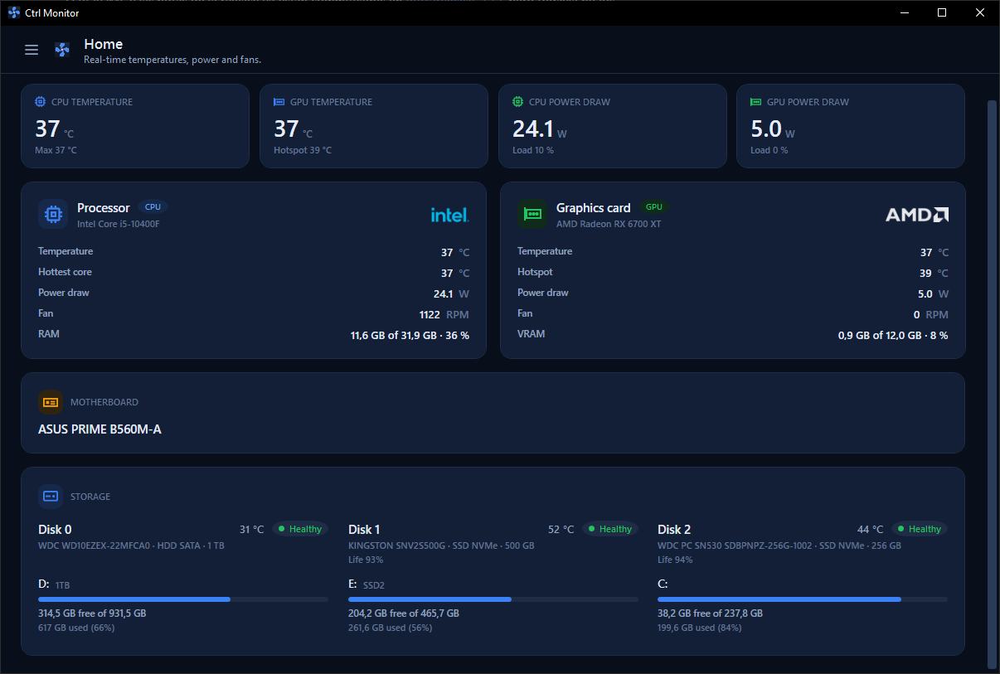

# Ctrl Monitor

**[English](#english) · [Español](#espanol)**



<a id="english"></a>

Windows desktop app that **shows in real time** temperatures, fan speeds, power, voltages, load, PWM, RAM and VRAM usage and network traffic. It also includes **disk health (S.M.A.R.T.)**, a **process manager** and an **in-game overlay with FPS**. Hardware access is **strictly read-only**: it never writes PWM, never applies fan curves and never changes the BIOS. The only actions that change the system are the ones you ask for in the process manager (ending a process) and, if you enable it, the startup scheduled task.

The interface is available in **English, Spanish and Portuguese (Brazil)**, lives in the system tray and can start with Windows. It includes **configurable chart panels**, a **fan view with RPM and PWM**, CPU/GPU/motherboard icons and the **logo of the detected brand**. **Fan control is left to the BIOS.**

> **Reference hardware:** ASUS PRIME B560M-A · Intel Core i5-10400F · AMD Radeon RX 6700 XT.

---

## Features

- **Home** with the key CPU, GPU, motherboard and storage values: temperature, hottest core, hot spot, power, load, RPM, GPU VRAM, disk health and disk temperature.
- **Live charts** with independent panels and a metric selector on each one: CPU, GPU, CPU/GPU load, board, hot spot, RAM, VRAM, disk and network. CPU, GPU and RAM are shown by default; the rest can be added from the top bar, any card can be removed with **✕** and cards can be **dragged** to reorder them (the order is saved). Each panel scales its vertical axis automatically and they all share a 1, 5 or 10 minute window. Fan RPM and current power draw are shown next to the temperature; RAM and VRAM show GB used out of the total and a percentage; network shows download and upload in MB/s; disk shows activity and read/write speed.
- **Fans** with every detected channel, its RPM and the PWM the BIOS is applying. The **Active only** box hides stopped channels.
- **Sensors** with every detected reading, grouped by component: temperatures, fans, power, voltages, load, PWM and GPU memory. Each group can be collapsed.
- **Disks** with the health and S.M.A.R.T. data of every drive, using the same engine as CrystalDiskInfo: condition (good, caution, bad), temperature, remaining life, power-on hours, data written and read, reallocated, pending and uncorrectable sectors, interface, firmware, serial number, the full attribute table and the volumes on each disk. Each card can be collapsed.
- **Processes** grouped by app, with CPU, memory, disk and network use, machine totals, sortable and resizable columns, search by name or PID, expandable groups and a context menu to open the file location, search online, view properties or end the task / process tree. Critical Windows processes are protected and can't be ended.
- **In-game overlay**: a compact bar that stays on top of games in fullscreen, without taking focus or catching clicks. Pick the metrics (FPS, CPU, GPU, RAM, network…), a minimal or colorful style or your own colors, text size, background opacity and square corners. Place it with 9 preset positions or by dragging it (with a guide grid), and lock it so it can't be moved by accident. `Ctrl+Alt+O` shows or hides it.
- **FPS** of the game in the foreground, measured with Intel's [PresentMon](https://github.com/GameTechDev/PresentMon) from the Windows presentation events: nothing is injected into the game and its memory isn't read. With frame generation (AMD AFMF or Intel XeSS-FG) it shows **FG** instead of FPS.
- **Detected hardware**: CPU, GPU, motherboard, Super I/O, installed RAM (modules and speed) and physical disks.
- **Live refresh** every 0.5–10 seconds.
- **Idle mode**: when the window is hidden or minimized and the overlay isn't on screen, it stops reading sensors and frees memory. It resumes instantly when you open the window or a fullscreen game shows the overlay.
- **Optional error reports**: the first time it opens, the app asks whether to send error reports. See [Privacy](#privacy).
- **Resizable, responsive window**: cards and charts switch between one and two columns depending on the width, designed with vertical 1080p monitors in mind.
- **Collapsible sidebar** with its own button or `Ctrl+B`; when hidden, the top bar shows the current page title and a button to bring it back.
- **Vector icons** for CPU, GPU and motherboard.
- **Brand detection:** shows the logo of the motherboard, CPU, GPU and disk brand when it's recognized. There are **56 brand logos** (see [Brand logos](#brand-logos)); known brands without a logo — Bangho, CHUWI, ENOVA, Gateway, HUANANZHI, MACHINIST, MEDION and VAIO — appear as a text badge.
- **System tray** icon with a CPU/GPU tooltip and a menu to open or exit.
- **Start with Windows** through a scheduled task with elevated permissions.
- **Multilingual**: English, Spanish and Portuguese (Brazil). It follows the Windows display language by default (English if that language isn't supported) and can be switched instantly from **Settings → Language**.
- **Saved preferences**: refresh rate, startup, tray behavior, sidebar, language, chart layout and overlay.

## What it doesn't do

- It doesn't control fans or write Super I/O PWM registers.
- No fan curves, profiles, manual modes or thermal emergency mode.
- It never restores or modifies BIOS settings.
- It doesn't keep history on disk: charts only keep the last 10 minutes in memory and start over when the app opens.
- It doesn't inject anything into games or read their memory: FPS come from Windows events.

The PWM shown in **Sensors** is a reading of the value the BIOS is applying at that moment.

## Installation

Download the latest version from [Releases](https://github.com/AgusTinMd/Ctrl-Monitoring/releases/latest):

| File | What it's for |
|---|---|
| `CtrlMonitorSetup-X.Y.Z.exe` | **Installer (recommended).** Installs to `C:\Program Files\Ctrl Monitor`, adds a Start menu shortcut (and optionally a desktop one), lets you choose the language and can install PawnIO for you; it can be removed from *Add or remove programs*. |
| `CtrlMonitor-X.Y.Z-win-x64-portable.zip` | Portable version. Extract the folder anywhere and run `CtrlMonitor.exe`. Keep `PresentMon.exe` next to it: it's used to measure FPS. |
| `SHA256SUMS.txt` | Hashes to check that the downloaded files weren't modified. |

You don't need to install .NET: it's bundled in the executable. Both downloads also include `PresentMon.exe` (Intel, MIT) for the overlay FPS.

The installer can download and install **[PawnIO](https://pawnio.eu/) 2.2.0** for you: it's offered as a checked task and the official installer is verified against its SHA-256 before running. PawnIO is the driver that lets the app read the motherboard sensors; without it the app still opens but shows fewer sensors. You can also install it later from [pawnio.eu](https://pawnio.eu/).

> **Windows SmartScreen warning.** The executable isn't digitally signed, so Windows may show *"Windows protected your PC"*. To continue, click **More info → Run anyway**. Some antivirus products are also wary of apps that read sensors at a low level; if you're concerned, compare the file against `SHA256SUMS.txt` or build it yourself.

If you install outside Program Files (for example `E:\Ctrl Monitor`), the installer restricts that folder so only administrators can modify it, because the startup task runs the app as administrator.

Uninstalling closes the app and removes the startup task. Your settings stay in `%APPDATA%\CtrlMonitor` in case you reinstall; you can delete that folder by hand.

## Requirements

- Windows 10/11, 64-bit.
- To build: .NET 10 SDK. Release downloads already include the runtime; a build of your own with `dotnet build` needs the [.NET 10 Desktop Runtime](https://dotnet.microsoft.com/download/dotnet/10.0).
- **PawnIO 2.2** installed. The installer offers to download and install it (SHA-256 verified). It's the signed driver LibreHardwareMonitor uses to access the Super I/O. Without it, the app can't see the motherboard sensor chip and shows fewer sensors.
- Administrator rights. The app manifest requires elevation (`requireAdministrator`); if it starts without them, it relaunches itself and asks for UAC.

## Build and run

```powershell
# Build the whole solution
dotnet build CtrlMonitor.slnx -c Release

# Run (asks for UAC)
Start-Process "src\CtrlMonitor.App\bin\Release\net10.0-windows\CtrlMonitor.exe" -Verb RunAs
```

The app **always** runs as administrator. `CtrlMonitor.exe` requires it through its manifest, and if it's started with `dotnet CtrlMonitor.dll` it detects it isn't elevated and relaunches through `CtrlMonitor.exe` with UAC. If the prompt is cancelled the app closes: there's no unprivileged mode.

### Tests

```powershell
dotnet test tests\CtrlMonitor.Core.Tests\CtrlMonitor.Core.Tests.csproj -c Release
```

The tests cover settings persistence and normalization (including legacy files with control fields that are no longer used), overlay settings, positions and text, FPS calculation from PresentMon output, chart layout, migration from FanCtrl, axis scaling, network speed conversion, translations (every language has the same keys and placeholders), automatic language selection, startup task parsing and the check that the executable lives in a folder only administrators can modify.

### Package and publish a release

**The version always comes from the git tag.** The csproj stays at `0.0.0` (local builds show "Ctrl Monitor (dev)" in Settings), so there's nothing to bump before a release.

`build\package.ps1` downloads PresentMon (verifying its SHA-256 with `build\get-presentmon.ps1`) and creates the self-contained executable, the portable zip, the installer and `SHA256SUMS.txt` in `artifacts\`. The installer needs [Inno Setup 6](https://jrsoftware.org/isinfo.php) (`winget install JRSoftware.InnoSetup`); without it, the script builds everything else and warns you.

```powershell
# Version from the latest vX.Y.Z tag
powershell -ExecutionPolicy Bypass -File build\package.ps1

# A specific version
powershell -ExecutionPolicy Bypass -File build\package.ps1 -Version 2.8.0
```

To publish on GitHub, merge `DEV` into `main` with a single PR and push a version tag on `main`. The [`release.yml`](.github/workflows/release.yml) workflow runs the tests, packages with the same script using the tag's version and creates the Release with the files:

```powershell
git tag v2.8.0
git push origin v2.8.0
```

The workflow can also be started by hand from **Actions → Release → Run workflow**: it produces the files as downloadable artifacts without publishing a Release (with an empty version it uses the latest tag). The installer script lives in [`installer/CtrlMonitor.iss`](installer/CtrlMonitor.iss).

## Usage

1. Open Ctrl Monitor and accept the UAC prompt.
2. In **Home**, check the CPU, GPU and power cards and the overall status.
3. In **Charts**, follow temperatures, memory and network over time. Each card has its own metric selector and automatic scale; pick 1, 5 or 10 minutes and use **Clear** to start over. Fan RPM and power draw are shown next to the temperature for CPU, GPU and hot spot; RAM and VRAM cards show GB used out of the total and a percentage; the network card shows download and upload. Use **Add** for another metric, **✕** to remove a card and drag cards to reorder them.
4. In **Fans**, each detected channel shows its RPM and the PWM applied by the BIOS. Channels at zero are dimmed; check **Active only** to hide them.
5. In **Sensors**, you get the full dump grouped by component. Rows with a bar are percentages (load and PWM). Click a group header to collapse or expand it.
6. In **Disks**, check the health and S.M.A.R.T. data of each drive.
7. In **Processes**, search, sort and end tasks. Right-click a row for more options.
8. In **Overlay**, turn on the in-game bar, choose its metrics, style and position, and lock it when it's where you want it. It appears by itself when a game is in fullscreen; `Ctrl+Alt+O` shows or hides it at any time.
9. In **Settings**, change the refresh interval, language, start with Windows, tray behavior and error reports. The **Detected hardware** card also summarizes installed RAM and physical disks.

The ☰ button in the sidebar header (or `Ctrl+B`) hides the sidebar. When it's hidden, the ☰ button in the top bar shows it again. One click on the tray icon opens the window; to quit completely, use **Exit** in its context menu.

## Settings and logs

| Item | Path |
|---|---|
| Settings | `%APPDATA%\CtrlMonitor\config.json` |
| Logs | `%APPDATA%\CtrlMonitor\logs\ctrlmonitor-YYYY-MM-DD.log` |

Settings keys:

| Key | Default | Description |
|---|---|---|
| `SchemaVersion` | `2` | File format version. v1 files are migrated by dropping the control fields. |
| `RefreshIntervalMs` | `1000` | Read interval, limited to 500–10000 ms. |
| `StartMinimized` | `false` | Starts hidden in the tray. |
| `MinimizeToTray` | `true` | Closing or minimizing the window hides it in the tray. |
| `RunAtStartup` | `false` | Creates the startup scheduled task. |
| `ShowNavigation` | `true` | Shows the navigation sidebar. |
| `ChartMetrics` | `["Cpu","Gpu","Ram"]` | Visible chart metrics, in order. Added, removed and reordered from the interface. |
| `Language` | `"auto"` | Interface language: `auto` (the Windows language), `es`, `en` or `pt-BR`. |
| `Overlay` | off | Overlay settings: on/off, metrics, colors, size, opacity and position. Changed from the **Overlay** page. |
| `SendErrorReports` | `false` | Sends error reports (see [Privacy](#privacy)). |
| `ErrorReportsAsked` | `false` | The app already asked about error reports, so it doesn't ask again. |
| `InstallId` | random | Random identifier of this installation, used only to group error reports. |

If the file gets corrupted, the app backs it up as `config.json.bak-*` and goes back to the defaults.

## Privacy

Ctrl Monitor doesn't send anything unless you allow it. The first time it opens it asks whether to send **error reports**, and you can change that anytime in **Settings → Data and diagnostics**. They're off until you say yes.

If you turn them on, when the app hits an error it sends it to [Sentry](https://sentry.io/) so it can be fixed:

- The error and its stack trace, with the last lines of the log before it.
- App version, Windows version and the CPU, GPU and motherboard model.
- A random installation ID, to tell whether several errors come from the same PC.

It **doesn't** send your user name, your PC name, your IP address, your location or your files: user and PC names are replaced in paths and messages before anything leaves your PC. The same error is sent once per session, with at most 25 reports per session. Without an internet connection, reports wait in `%APPDATA%\CtrlMonitor\error-reports` until the next time the app opens.

## Feedback

Found a bug or have an idea? Open **Settings → Data and diagnostics** in the app and use **Report a bug** or **Suggest an improvement**: the GitHub form opens with the version and your hardware already filled in. You can also go straight to [Issues](https://github.com/AgusTinMd/Ctrl-Monitoring/issues/new/choose), or ask questions and talk through ideas in [Discussions](https://github.com/AgusTinMd/Ctrl-Monitoring/discussions).

## Start with Windows

The **Start with Windows** option creates a scheduled task named `CtrlMonitor` with `/RL HIGHEST` and a 20-second delay, so UAC doesn't prompt at every startup. If the app finds the task pointing to another copy of the executable, it updates it only when its own folder can be modified exclusively by administrators (Program Files or a folder restricted by the installer); a build from the repository or a portable copy in Downloads won't take over the task. You can remove it from the same option or with:

```powershell
schtasks /Delete /TN CtrlMonitor /F
```

## Upgrading from FanCtrl

Up to version 2.5.0 the app was called **FanCtrl Monitor** (`FanCtrl.exe`). The name changed because it's no longer a fan tool but a general hardware monitor. The first time Ctrl Monitor opens:

- If `%APPDATA%\CtrlMonitor\config.json` doesn't exist, `%APPDATA%\FanCtrl\config.json` is copied. The old folder isn't deleted.
- If the `FanCtrl` scheduled task exists, it's removed and, if start with Windows was on, `CtrlMonitor` is created pointing to the new executable.

Old logs stay in `%APPDATA%\FanCtrl\logs`. You can delete that folder by hand once you no longer need it.

## Project structure

```
src/CtrlMonitor.Core/      UI-independent logic
  Hardware/                LibreHardwareMonitor, readings and snapshots
  Inventory/               WMI RAM and disk info, memory usage and network traffic
  Overlay/                 Overlay metrics, colors, positions and text
  Fps/                     FPS with PresentMon
  Configuration/           Settings model and persistence
  Diagnostics/             Logs, startup task parsing, install location check
  Localization/            Languages and translated texts (es, en, pt-BR)
src/CtrlMonitor.App/       WPF
  Themes/Theme.xaml        Palette, styles, vector icons and navigation
  Controls/LiveChart.cs    Live chart, per series or combined
  Controls/ResponsiveGrid.cs  Responsive card panel
  Localization/            {l:Tr key} markup extension for translated XAML texts
  Models/ChartSample.cs    Chart sample with temperatures, memory and network
  Converters/              Time window, columns and UI converters
  ViewModels/              MainViewModel, chart panels, sensor groups and fans
  Services/                Tray, overlay, error reports, start with Windows and elevation
  Assets/*.png             Brand logos (56 brands)
tests/CtrlMonitor.Core.Tests/  xUnit tests
tools/CtrlMonitor.Probe/   Read-only probe for elevated diagnostics
build/package.ps1          Packaging: self-contained exe, zip, installer and hashes
build/get-presentmon.ps1   Downloads PresentMon and verifies its SHA-256
docs/                      README screenshot
installer/CtrlMonitor.iss  Inno Setup installer
.github/workflows/         Automatic release when a vX.Y.Z tag is pushed
LICENSE                    MIT license
LICENSES/                  Third-party license texts
THIRD-PARTY-NOTICES.md     Third-party notices and brand trademarks
```

## Diagnostic probe

`tools/CtrlMonitor.Probe` dumps every sensor LibreHardwareMonitor sees, using the same hardware settings as the app. It helps compare readings when something is missing:

```powershell
# From an elevated terminal (the probe requires administrator)
dotnet run --project tools\CtrlMonitor.Probe -c Release
```

It writes `probe-output.txt` next to the executable. It never writes PWM or touches the BIOS. Add `--pause` to make the console wait for ENTER before closing.

## Known limitations

- **Charts**: all panels share the same time window and history lives only in memory; it's lost when the app closes. Long refresh intervals mean fewer points per minute.
- **Fans**: channels without their own sensor show `0 RPM` or `—` for PWM. Which header each channel is (CPU_FAN, SYS_FAN, etc.) depends on the motherboard and isn't guessed.
- **Other motherboards / Super I/O chips**: sensor names and counts depend on the chip. The app shows whatever LibreHardwareMonitor detects; there's no model-specific mapping.
- **Missing sensors**: without PawnIO or administrator rights the Super I/O doesn't respond, so motherboard RPM, voltages and PWM are missing.
- **RAM and disks**: read once through WMI. If WMI is disabled or fails, the card shows `Not available` and the rest of the app keeps working.
- **GPU**: power, hot spot and VRAM depend on driver support. If the vendor doesn't expose them they show as `—`.
- **Network**: speed adds up the active physical Ethernet and Wi-Fi interfaces; VPNs and virtual adapters are excluded so traffic isn't counted twice. The value is the instantaneous rate between refreshes.
- **UAC**: the app needs administrator rights; start with Windows uses a scheduled task so it doesn't prompt every time.
- **Antivirus / anti-cheat**: some of them block direct Super I/O access. If sensors are missing, check the logs and PawnIO.
- **FPS**: they're measured for the game in fullscreen in the foreground. The **FG** label shows up with AMD AFMF and Intel XeSS-FG; NVIDIA DLSS frame generation isn't reported by Windows, so it counts as FPS.
- **Idle mode**: while the window is hidden and the overlay isn't on screen, charts get no new points, so they show a gap for that time.
- **Translations**: sensor names that come from the hardware (for example "CPU Package" or "Fan #4") and the logs aren't translated. Numbers follow the Windows regional format.

## Brand logos

Ctrl Monitor includes logos for these brands:

- **Motherboards, GPUs and chips:** ASUS, GIGABYTE, MSI, ASRock, BIOSTAR, EVGA, NZXT, Supermicro, COLORFUL, MAXSUN, Intel, AMD, NVIDIA, ZOTAC, ECS, Foxconn, Clevo.
- **Prebuilt PCs and laptops:** Dell, Alienware, HP, Lenovo, Acer, Apple, Microsoft, Samsung, Dynabook, Toshiba, Sony, Huawei, Xiaomi, Razer, LG, Fujitsu, Framework, System76, Packard Bell, Positivo, BGH, EXO, Noblex.
- **Storage:** Western Digital, Seagate, SanDisk, Kingston, Crucial, KIOXIA, ADATA, Corsair, SK hynix, Micron, HGST, Hitachi, Lexar, Teamgroup, Patriot, PNY.

Known brands without a logo — Bangho, CHUWI, ENOVA, Gateway, HUANANZHI, MACHINIST, MEDION and VAIO — are shown as a text badge.

## Trademarks

All product names, brands and logos are trademarks or registered trademarks of their respective owners. Ctrl Monitor is not affiliated with or endorsed by any of them. The logos are used only to identify the detected hardware.

## License

MIT — see [LICENSE](LICENSE). You can use, modify and redistribute the source code and the original assets as long as you keep the copyright notice. Brand logos are trademarks of their respective owners and are not covered by this license; see [THIRD-PARTY-NOTICES.md](THIRD-PARTY-NOTICES.md).

---

<a id="espanol"></a>

# Ctrl Monitor (español)

**[English](#english) · [Español](#espanol)**


Aplicación de escritorio para Windows que **muestra en tiempo real** las temperaturas, la velocidad de los ventiladores, la potencia, los voltajes, la carga, el PWM, el uso de RAM y VRAM y el tráfico de red. También incluye la **salud de los discos (S.M.A.R.T.)**, un **administrador de procesos** y un **overlay para juegos con FPS**. El acceso al hardware es **estrictamente de solo lectura**: no escribe PWM, no aplica curvas y no modifica el BIOS. Las únicas acciones que cambian el sistema son las que pedís desde el administrador de procesos (finalizar un proceso) y, si la activás, la tarea programada de inicio.

La interfaz está en **español, inglés y portugués (Brasil)**, vive en la bandeja del sistema y puede arrancar con Windows. Incluye **paneles de gráfico configurables**, una **vista de ventiladores con RPM y PWM**, iconos de CPU/GPU/placa y el **logo de la marca detectada**. El **control de los ventiladores queda a cargo del BIOS**.

> **Hardware de referencia:** ASUS PRIME B560M-A · Intel Core i5-10400F · AMD Radeon RX 6700 XT.

## Qué hace

- **Inicio** con los valores destacados de CPU, GPU, placa y almacenamiento: temperatura, máxima de núcleos, hotspot, potencia, carga, RPM, VRAM de la GPU, salud y temperatura de los discos.
- **Gráfico en vivo** con paneles independientes y un selector de métrica en cada uno: CPU, GPU, carga de CPU/GPU, placa, hotspot, RAM, VRAM, disco y red. Por defecto se muestran CPU, GPU y RAM; el resto se agrega desde la barra superior, cualquier tarjeta se puede quitar con la **✕** y se reordenan **arrastrándolas** (el orden se guarda). Cada panel ajusta su escala vertical y comparte las ventanas de 1, 5 o 10 minutos. Las RPM del ventilador y el consumo actual en vatios aparecen junto a la temperatura; RAM y VRAM muestran GB en uso sobre el total y porcentaje; la red muestra bajada y subida en MB/s; el disco muestra actividad y velocidad de lectura/escritura.
- **Ventiladores** con cada canal detectado, sus RPM y el PWM que está aplicando el BIOS. La casilla **Solo activos** oculta los canales detenidos.
- **Sensores** con todas las lecturas detectadas, agrupadas por componente: temperaturas, ventiladores, potencia, voltajes, carga, PWM y memoria de la GPU. Cada grupo se puede plegar o desplegar.
- **Discos** con la salud y los datos S.M.A.R.T. de cada unidad, con el mismo motor que CrystalDiskInfo: estado (bueno, en riesgo, malo), temperatura, vida útil restante, horas de encendido, datos escritos y leídos, sectores reasignados, pendientes e incorregibles, interfaz, firmware, número de serie, la tabla completa de atributos y los volúmenes de cada disco. Cada ficha se puede plegar.
- **Procesos** agrupados por aplicación, con uso de CPU, memoria, disco y red, totales del equipo, columnas ordenables y redimensionables, búsqueda por nombre o PID, grupos desplegables y un menú contextual para abrir la ubicación del archivo, buscar en línea, ver las propiedades o finalizar la tarea / el árbol de procesos. Los procesos críticos de Windows están protegidos y no se pueden finalizar.
- **Overlay para juegos**: una barra compacta que queda encima del juego en pantalla completa, sin quitarle el foco ni atrapar los clics. Elegís las métricas (FPS, CPU, GPU, RAM, red…), un estilo minimalista o variado o tus propios colores, el tamaño del texto, la opacidad del fondo y los bordes rectos. Se ubica con 9 posiciones fijas o arrastrándola (con una grilla de guía) y se bloquea para no moverla sin querer. `Ctrl+Alt+O` la muestra u oculta.
- **FPS** del juego en primer plano, medidos con [PresentMon](https://github.com/GameTechDev/PresentMon) de Intel a partir de los eventos de presentación de Windows: no se inyecta nada en el juego ni se lee su memoria. Con generación de cuadros (AMD AFMF o Intel XeSS-FG) muestra **FG** en lugar de FPS.
- **Hardware detectado** con CPU, GPU, placa, Super I/O, cantidad de RAM (módulos y velocidad) y discos físicos.
- **Actualización en vivo** cada 0,5–10 segundos.
- **Modo reposo**: con la ventana oculta o minimizada y sin el overlay en pantalla, deja de leer los sensores y libera memoria. Vuelve al instante al abrir la ventana o cuando un juego en pantalla completa muestra el overlay.
- **Informes de errores opcionales**: la primera vez que se abre, la app pregunta si querés enviarlos. Ver [Privacidad](#privacidad).
- **Ventana redimensionable y adaptable**: las tarjetas y los gráficos pasan a una o dos columnas según el ancho, pensado para monitores verticales de 1080p.
- **Barra lateral colapsable** con el botón integrado en su cabecera o `Ctrl+B`; al ocultarla, la barra superior muestra el título de la página y un botón para reabrirla.
- **Iconos vectoriales** de CPU, GPU y placa madre.
- **Detección de marca:** muestra el logo de la placa, del CPU, de la GPU y del disco cuando reconoce la marca. Hay **56 logos de marcas** (ver [Logos de marcas](#logos-de-marcas)); las marcas conocidas sin logo —Bangho, CHUWI, ENOVA, Gateway, HUANANZHI, MACHINIST, MEDION y VAIO— aparecen como una insignia de texto.
- **Bandeja del sistema** con tooltip de CPU/GPU y menú para abrir o salir.
- **Inicio con Windows** mediante tarea programada con permisos altos.
- **Multilenguaje**: español, inglés y portugués (Brasil). Por defecto sigue el idioma de Windows (inglés si no está soportado) y se cambia al instante desde **Ajustes → Idioma**.
- **Persistencia** de las preferencias de refresco, arranque, bandeja, barra lateral, idioma, el layout de los gráficos y el overlay.

## Qué no hace

- No controla ventiladores ni escribe registros PWM del Super I/O.
- No incluye curvas, perfiles, modos manuales ni emergencia térmica.
- No restaura ni modifica la configuración del BIOS: nunca la cambia.
- No guarda historial en disco: el gráfico solo retiene los últimos 10 minutos en memoria y se reinicia al abrir la app.
- No inyecta nada en los juegos ni lee su memoria: los FPS salen de eventos de Windows.

El PWM que aparece en la pestaña **Sensores** es una lectura del valor que está aplicando el BIOS en ese momento.

## Instalación

Descargá la última versión desde [Releases](https://github.com/AgusTinMd/Ctrl-Monitoring/releases/latest):

| Archivo | Para qué |
|---|---|
| `CtrlMonitorSetup-X.Y.Z.exe` | **Instalador (recomendado).** Instala en `C:\Program Files\Ctrl Monitor`, crea el acceso directo en el menú Inicio (y opcionalmente en el escritorio), permite elegir el idioma y puede instalar PawnIO por vos; se desinstala desde *Agregar o quitar programas*. |
| `CtrlMonitor-X.Y.Z-win-x64-portable.zip` | Versión portable. Descomprimí la carpeta donde quieras y ejecutá `CtrlMonitor.exe`. Dejá `PresentMon.exe` al lado: se usa para medir los FPS. |
| `SHA256SUMS.txt` | Hashes para verificar que los archivos descargados no se modificaron. |

No hace falta instalar .NET: el ejecutable ya lo incluye. Las dos descargas traen también `PresentMon.exe` (Intel, MIT) para los FPS del overlay.

El instalador puede descargar e instalar **[PawnIO](https://pawnio.eu/) 2.2.0** por vos: aparece como una tarea marcada y el instalador oficial se verifica contra su SHA-256 antes de ejecutarse. PawnIO es el driver que permite leer los sensores de la placa madre; sin él la app igual abre, pero muestra menos sensores. También podés instalarlo después desde [pawnio.eu](https://pawnio.eu/).

> **Aviso de Windows SmartScreen.** El ejecutable no está firmado digitalmente, así que Windows puede mostrar *«Windows protegió su PC»*. Para continuar tocá **Más información → Ejecutar de todas formas**. Algunos antivirus también desconfían de las apps que leen sensores a bajo nivel; si te preocupa, compará el archivo con `SHA256SUMS.txt` o compilalo vos mismo.

Si instalás fuera de Program Files (por ejemplo en `E:\Ctrl Monitor`), el instalador restringe esa carpeta para que solo los administradores puedan modificarla, porque la tarea de inicio ejecuta la app como administrador.

Al desinstalar se cierra la app y se borra la tarea de inicio automático. Tu configuración queda en `%APPDATA%\CtrlMonitor` por si volvés a instalarla; podés borrar esa carpeta a mano.

## Requisitos

- Windows 10/11 de 64 bits.
- Para compilar: .NET 10 SDK. Las versiones de Releases ya incluyen el runtime; un build propio con `dotnet build` necesita el [.NET 10 Desktop Runtime](https://dotnet.microsoft.com/download/dotnet/10.0).
- **PawnIO 2.2** instalado. El instalador ofrece descargarlo e instalarlo (con verificación SHA-256). Es el driver firmado que usa LibreHardwareMonitor para acceder al Super I/O. Sin él, la app no detecta el chip de sensores de la placa y muestra menos sensores.
- Permisos de administrador. El manifiesto de la app exige elevación (`requireAdministrator`); si se inicia sin privilegios, se relanza sola y pide UAC.

## Compilar y ejecutar

```powershell
# Compilar toda la solución
dotnet build CtrlMonitor.slnx -c Release

# Ejecutar (pide UAC)
Start-Process "src\CtrlMonitor.App\bin\Release\net10.0-windows\CtrlMonitor.exe" -Verb RunAs
```

La app **siempre** se ejecuta como administrador. `CtrlMonitor.exe` lo exige desde el manifiesto y, si se inicia con `dotnet CtrlMonitor.dll`, detecta que no está elevada y se relanza sola con UAC a través de `CtrlMonitor.exe`. Si se cancela el cartel, la app se cierra: no queda un modo sin privilegios.

### Tests

```powershell
dotnet test tests\CtrlMonitor.Core.Tests\CtrlMonitor.Core.Tests.csproj -c Release
```

Los tests cubren la persistencia y normalización de la configuración (incluida la lectura de archivos legacy con campos de control que ya no se usan), los ajustes, las posiciones y el texto del overlay, el cálculo de FPS a partir de la salida de PresentMon, el layout de gráficos, la migración desde FanCtrl, la escala de los ejes, la conversión de velocidades de red, las traducciones (todos los idiomas con las mismas claves y marcadores), la elección automática del idioma, la lectura de la tarea de inicio y la comprobación de que el ejecutable esté en una carpeta que solo los administradores pueden modificar.

### Empaquetar y publicar una versión

**La versión sale siempre del tag de git.** El csproj queda fijo en `0.0.0` (una compilación local muestra «Ctrl Monitor (dev)» en Ajustes), así que no hay que cambiar nada antes de publicar.

`build\package.ps1` descarga PresentMon (verificando su SHA-256 con `build\get-presentmon.ps1`) y genera en `artifacts\` el exe autocontenido, el zip portable, el instalador y `SHA256SUMS.txt`. El instalador necesita [Inno Setup 6](https://jrsoftware.org/isinfo.php) (`winget install JRSoftware.InnoSetup`); sin él, el script arma el resto y avisa.

```powershell
# Versión del último tag vX.Y.Z
powershell -ExecutionPolicy Bypass -File build\package.ps1

# Una versión en particular
powershell -ExecutionPolicy Bypass -File build\package.ps1 -Version 2.8.0
```

Para publicar en GitHub, pasá `DEV` a `main` con un solo PR y subí un tag con la versión sobre `main`. El workflow [`release.yml`](.github/workflows/release.yml) corre los tests, empaqueta con el mismo script usando la versión del tag y crea la Release con los archivos:

```powershell
git tag v2.8.0
git push origin v2.8.0
```

El workflow también se puede lanzar a mano desde **Actions → Release → Run workflow**: genera los archivos como artefactos descargables sin publicar una Release (con la versión vacía usa el último tag). El script del instalador está en [`installer/CtrlMonitor.iss`](installer/CtrlMonitor.iss).

## Uso

1. Abrí Ctrl Monitor y aceptá el cartel de UAC.
2. En **Inicio** revisá las tarjetas de CPU, GPU, potencia y el estado general.
3. En **Gráfico** seguí la evolución de las temperaturas, la memoria y la red. Cada tarjeta tiene su propio selector de métrica y escala automática; elegí 1, 5 o 10 minutos y usá **Limpiar** para reiniciar el trazado. Las RPM del ventilador y el consumo en vatios se muestran junto a la temperatura en CPU, GPU y hotspot; las tarjetas de RAM y VRAM muestran los GB en uso sobre el total y el porcentaje; la de red muestra bajada y subida. Usá **Agregar** para sumar otra métrica, la **✕** de una tarjeta para quitarla y arrastrá las tarjetas para reordenarlas.
4. En **Ventiladores** está cada canal detectado con sus RPM y el PWM aplicado por el BIOS. Los canales en cero se muestran atenuados; activá **Solo activos** para ocultarlos.
5. En **Sensores** está el volcado completo agrupado por componente. Las filas con barra son porcentajes (carga y PWM). Tocá la cabecera de un grupo para plegarlo o desplegarlo.
6. En **Discos** revisá la salud y los datos S.M.A.R.T. de cada unidad.
7. En **Procesos** buscá, ordená y finalizá tareas. Con clic derecho sobre una fila hay más opciones.
8. En **Overlay** activá la barra para juegos, elegí sus métricas, el estilo y la posición, y bloqueala cuando quede donde querés. Aparece sola cuando un juego está en pantalla completa; `Ctrl+Alt+O` la muestra u oculta en cualquier momento.
9. En **Ajustes** cambiá el intervalo de refresco, el idioma, el inicio con Windows, el comportamiento de la bandeja y los informes de errores. La tarjeta **Hardware detectado** resume también la RAM instalada y los discos físicos.

El botón ☰ de la cabecera de la barra lateral (o `Ctrl+B`) la oculta. Cuando está oculta, el botón ☰ de la barra superior la vuelve a mostrar. El icono de la bandeja abre la ventana con un clic. Para cerrar del todo usá **Salir** en su menú contextual.

## Configuración y logs

| Dato | Ruta |
|---|---|
| Configuración | `%APPDATA%\CtrlMonitor\config.json` |
| Logs | `%APPDATA%\CtrlMonitor\logs\ctrlmonitor-AAAA-MM-DD.log` |

Claves de configuración:

| Clave | Valor por defecto | Descripción |
|---|---|---|
| `SchemaVersion` | `2` | Versión del formato. Los archivos v1 se migran descartando los campos de control. |
| `RefreshIntervalMs` | `1000` | Intervalo de lectura. Se limita a 500–10000 ms. |
| `StartMinimized` | `false` | Arranca oculto en la bandeja. |
| `MinimizeToTray` | `true` | Cerrar o minimizar la ventana la oculta en la bandeja. |
| `RunAtStartup` | `false` | Crea la tarea programada de inicio. |
| `ShowNavigation` | `true` | Muestra la barra lateral de navegación. |
| `ChartMetrics` | `["Cpu","Gpu","Ram"]` | Métricas visibles del modo gráfico, en orden. Se agregan, quitan y reordenan desde la interfaz. |
| `Language` | `"auto"` | Idioma de la interfaz: `auto` (el de Windows), `es`, `en` o `pt-BR`. |
| `Overlay` | apagado | Ajustes del overlay: activación, métricas, colores, tamaño, opacidad y posición. Se cambian desde la página **Overlay**. |
| `SendErrorReports` | `false` | Envía informes de errores (ver [Privacidad](#privacidad)). |
| `ErrorReportsAsked` | `false` | La app ya preguntó por los informes de errores y no vuelve a preguntar. |
| `InstallId` | al azar | Identificador al azar de esta instalación; solo sirve para agrupar los informes de errores. |

Si el archivo se corrompe, la app lo respalda como `config.json.bak-*` y vuelve a los valores por defecto.

## Privacidad

Ctrl Monitor no envía nada si no lo permitís. La primera vez que se abre pregunta si querés enviar **informes de errores**, y podés cambiarlo cuando quieras en **Ajustes → Datos y diagnóstico**. Están desactivados hasta que digas que sí.

Si los activás, cuando la app tiene un error lo envía a [Sentry](https://sentry.io/) para poder arreglarlo:

- El error y su stack trace, con las últimas líneas del log antes del fallo.
- La versión de la app, la de Windows y el modelo de CPU, GPU y placa.
- Un ID de instalación al azar, para saber si varios errores vienen de la misma PC.

**No** envía tu nombre de usuario, el de la PC, tu dirección IP, tu ubicación ni tus archivos: los nombres de usuario y de la PC se reemplazan en rutas y mensajes antes de salir del equipo. Cada error se envía una sola vez por sesión, con un máximo de 25 informes por sesión. Sin conexión, los informes esperan en `%APPDATA%\CtrlMonitor\error-reports` hasta la próxima vez que se abra la app.

## Comentarios y sugerencias

¿Encontraste un error o tenés una idea? En la app, entrá a **Ajustes → Datos y diagnóstico** y usá **Reportar un error** o **Sugerir una mejora**: se abre el formulario de GitHub con la versión y tu hardware ya completados. También podés ir directo a [Issues](https://github.com/AgusTinMd/Ctrl-Monitoring/issues/new/choose), o hacer preguntas y charlar ideas en [Discussions](https://github.com/AgusTinMd/Ctrl-Monitoring/discussions).

## Inicio con Windows

La opción **Iniciar con Windows** crea una tarea programada llamada `CtrlMonitor` con `/RL HIGHEST` y 20 segundos de retraso. Así se evita el cartel de UAC en cada inicio. Si la app encuentra la tarea apuntando a otra copia del ejecutable, la actualiza solo cuando su propia carpeta la pueden modificar únicamente los administradores (Program Files o una carpeta restringida por el instalador); un build del repositorio o una copia portable en Descargas no toman la tarea. Se elimina desde la misma opción o con:

```powershell
schtasks /Delete /TN CtrlMonitor /F
```

## Actualizar desde FanCtrl

Hasta la versión 2.5.0 la app se llamaba **FanCtrl Monitor** (`FanCtrl.exe`). El nombre cambió porque dejó de ser una herramienta de ventiladores y pasó a ser un monitor general. Al abrir Ctrl Monitor por primera vez:

- Si no existe `%APPDATA%\CtrlMonitor\config.json`, se copia `%APPDATA%\FanCtrl\config.json`. La carpeta vieja no se borra.
- Si existe la tarea programada `FanCtrl`, se elimina y, si el inicio con Windows estaba activo, se crea `CtrlMonitor` apuntando al ejecutable nuevo.

Los logs viejos quedan en `%APPDATA%\FanCtrl\logs`. Cuando ya no los necesites, podés borrar esa carpeta a mano.

## Estructura del proyecto

```
src/CtrlMonitor.Core/      Lógica sin UI
  Hardware/                LibreHardwareMonitor, lecturas y snapshots
  Inventory/               Lectura WMI de RAM y discos, uso de memoria y tráfico de red
  Overlay/                 Métricas, colores, posiciones y texto del overlay
  Fps/                     FPS con PresentMon
  Configuration/           Modelo y persistencia
  Diagnostics/             Logs, lectura de la tarea de inicio y ubicación de instalación
  Localization/            Idiomas y textos traducidos (es, en, pt-BR)
src/CtrlMonitor.App/       WPF
  Themes/Theme.xaml        Paleta, estilos, iconos vectoriales y navegación
  Controls/LiveChart.cs    Gráfico en vivo por serie o combinado
  Controls/ResponsiveGrid.cs  Panel adaptable de tarjetas
  Localization/            Extensión {l:Tr clave} para los textos traducidos en XAML
  Models/ChartSample.cs    Muestra de temperaturas, memoria y red del gráfico
  Converters/              Ventana temporal, columnas y conversores de UI
  ViewModels/              MainViewModel, paneles de gráfico, grupos y ventiladores
  Services/                Bandeja, overlay, informes de errores, inicio con Windows y elevación
  Assets/*.png             Logos de marcas (56 marcas)
tests/CtrlMonitor.Core.Tests/  Tests xUnit
tools/CtrlMonitor.Probe/   Sonda de solo lectura para diagnóstico elevado
build/package.ps1          Empaquetado: exe autocontenido, zip, instalador y hashes
build/get-presentmon.ps1   Descarga PresentMon y verifica su SHA-256
docs/                      Captura del README
installer/CtrlMonitor.iss  Instalador de Inno Setup
.github/workflows/         Release automática al subir un tag vX.Y.Z
LICENSE                    Licencia MIT
LICENSES/                  Textos de licencias de terceros
THIRD-PARTY-NOTICES.md     Avisos de terceros y marcas
```

## Sonda de diagnóstico

`tools/CtrlMonitor.Probe` vuelca todos los sensores que ve LibreHardwareMonitor, con la misma configuración de hardware que la app. Sirve para comparar lecturas cuando falta algún dato:

```powershell
# Desde una terminal elevada (la sonda pide administrador)
dotnet run --project tools\CtrlMonitor.Probe -c Release
```

Escribe `probe-output.txt` junto al ejecutable. No escribe PWM ni toca el BIOS. Agregá `--pause` para que la consola espere un ENTER antes de cerrarse.

## Limitaciones conocidas

- **Gráfico**: los paneles comparten la misma ventana temporal y el historial vive solo en memoria; al cerrar la app se pierde. Con intervalos de refresco largos hay menos puntos por minuto.
- **Ventiladores**: los canales sin sensor propio muestran `0 RPM` o `—` en PWM. El mapeo de cada canal (CPU_FAN, SYS_FAN, etc.) depende de la placa y no se inventa.
- **Otra placa/Super I/O**: los nombres y la cantidad de sensores dependen del chip. La app muestra lo que LibreHardwareMonitor detecte; no hay mapeo específico por modelo.
- **Sensores ausentes**: sin PawnIO o sin administrador, el Super I/O no responde y faltan RPM, voltajes y PWM de la placa.
- **RAM y discos**: se leen una sola vez con WMI. Si WMI está deshabilitado o devuelve un error, la tarjeta muestra `No disponible` y el resto de la app sigue funcionando.
- **GPU**: la potencia, el hotspot y la VRAM dependen del soporte del driver. Si el fabricante no los expone, aparecen como `—`.
- **Red**: la velocidad suma las interfaces físicas Ethernet y Wi-Fi activas; las VPN y adaptadores virtuales se excluyen para no mezclar tráfico. El valor es la tasa instantánea entre refrescos.
- **UAC**: la app necesita administrador; el inicio automático usa una tarea programada para no pedirlo cada vez.
- **Antivirus/anti-cheat**: algunos sistemas bloquean el acceso directo al Super I/O. Si faltan sensores, revisá los logs y PawnIO.
- **FPS**: se miden del juego en pantalla completa en primer plano. El rótulo **FG** aparece con AMD AFMF e Intel XeSS-FG; la generación de cuadros de NVIDIA DLSS no la informa Windows, así que cuenta como FPS.
- **Modo reposo**: mientras la ventana está oculta y el overlay no está en pantalla, el gráfico no suma puntos, así que muestra un hueco por ese tiempo.
- **Traducciones**: los nombres de sensores que vienen del hardware (por ejemplo «CPU Package» o «Fan #4») y los logs no se traducen. Los números siguen el formato regional de Windows.

## Logos de marcas

Ctrl Monitor incluye logos de estas marcas:

- **Placas madre, GPU y chips:** ASUS, GIGABYTE, MSI, ASRock, BIOSTAR, EVGA, NZXT, Supermicro, COLORFUL, MAXSUN, Intel, AMD, NVIDIA, ZOTAC, ECS, Foxconn, Clevo.
- **PCs y notebooks de marca:** Dell, Alienware, HP, Lenovo, Acer, Apple, Microsoft, Samsung, Dynabook, Toshiba, Sony, Huawei, Xiaomi, Razer, LG, Fujitsu, Framework, System76, Packard Bell, Positivo, BGH, EXO, Noblex.
- **Almacenamiento:** Western Digital, Seagate, SanDisk, Kingston, Crucial, KIOXIA, ADATA, Corsair, SK hynix, Micron, HGST, Hitachi, Lexar, Teamgroup, Patriot, PNY.

Las marcas conocidas sin logo —Bangho, CHUWI, ENOVA, Gateway, HUANANZHI, MACHINIST, MEDION y VAIO— se muestran como una insignia de texto.

## Marcas

Todos los nombres de productos, marcas y logos son marcas comerciales o marcas registradas de sus respectivos dueños. Ctrl Monitor no está afiliado ni respaldado por ninguna de ellas. Los logos se usan únicamente para identificar el hardware detectado.

## Licencia

MIT — ver [LICENSE](LICENSE). Podés usar, modificar y redistribuir el código fuente y los recursos originales siempre que conserves el aviso de copyright. Los logos de marcas son marcas de sus respectivos dueños y no están cubiertos por esta licencia; ver [THIRD-PARTY-NOTICES.md](THIRD-PARTY-NOTICES.md).
